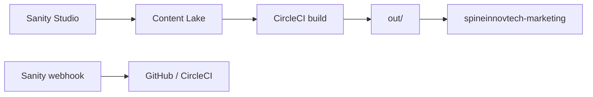

# Content operations (Sanity + static export)

## Quick Start (One-Time Setup)

1. **Create Sanity project**: Go to [https://www.sanity.io/manage](https://www.sanity.io/manage) → Create Project → Note the **Project ID**
2. **Create dataset**: In your project, create dataset `production`
3. **Get tokens**: In project settings → API → Create a read token and a write token
4. **Set CircleCI env vars**:
   - `SANITY_PROJECT_ID` = your project ID
   - `SANITY_DATASET` = `production`
   - `SANITY_API_READ_TOKEN` = read token from step 3
5. **Deploy schema**: `npx sanity schema deploy`
6. **Migrate content**: `SANITY_API_WRITE_TOKEN=xxx npm run content:migrate`
7. **Verify build**: Push to main, CircleCI will fetch CMS content

## Roles

| System | Role |
| --- | --- |
| **Sanity Studio** | Editorial UI (`npm run sanity:dev` locally, or hosted `sanity deploy`) |
| **Sanity Content Lake** | Source of truth for published blog articles |
| **GitHub** | Application code, schema in `sanity/schemaTypes/` |
| **CircleCI** | `npm run build` fetches published CMS content and exports static `out/` |
| **Cloudflare Worker** | Serves `out/` as static assets (no runtime CMS calls in production) |



## ContentRepository

Pages and build scripts use `getContentRepository()` from [`lib/content/`](../lib/content/index.ts). They do **not** import `@sanity/client` or GROQ directly.

| Env | Behavior |
| --- | --- |
| `SANITY_PROJECT_ID` set | Sanity adapter (published documents only) |
| Missing Sanity env | Legacy fallback from `content/blog/` (local dev warning) |

Set `CONTENT_PROVIDER=legacy` to force legacy during development.

## Schema (P0)

| Type | Purpose |
| --- | --- |
| `article` | Blog/research posts (portable text `content`, SEO, author, category, topics, tags) |
| `author` | Byline, bio, image |
| `category` | Pillar-aligned categories |
| `topic` | Taxonomy tags |
| `seo` | Meta title/description, canonical path, noIndex |
| Stubs | `news`, `changelogEntry`, `caseStudy`, `guide`, `resource`, `pressRelease`, `event`, `product`, `industry` (schema only; routes in P1) |

**Article fields (high level):** `title`, `slug`, `excerpt`, `content`, `status`, `kind` (`blog` \| `research`), `publishedAt`, `author`, `category`, `topics[]`, `tags[]`, `featured`, `featuredImage`, `readingTimeLabel`, `seo`.

Production builds query **`status == "published"`** and exclude draft document IDs (`drafts.**`).

## Editorial pillars

| Pillar | Example categories |
| --- | --- |
| Product | Product, Workspace |
| Business context | Operational intelligence |
| Governance and trust | AI governance, approval workflows |
| Research | Long-form research (P1 routes) |
| Company | News, press (P1) |

## Environment variables

See [`.env.example`](../.env.example).

| Variable | Where | Purpose |
| --- | --- | --- |
| `SANITY_PROJECT_ID` | CircleCI + local build | Project ID |
| `SANITY_DATASET` | CircleCI + local | Usually `production` |
| `SANITY_API_READ_TOKEN` | CircleCI + local build | Read published content (keep secret) |
| `SANITY_API_WRITE_TOKEN` | Local / one-off migration only | `npm run content:migrate` |

## Initial setup

1. Create a Sanity project and `production` dataset at [sanity.io/manage](https://www.sanity.io/manage).
2. Deploy schema: set `SANITY_PROJECT_ID`, then `npx sanity schema deploy` (or open Studio and confirm types load).
3. Create a **read** token (Viewer or custom read-only) for CI.
4. Migrate legacy posts: `SANITY_API_WRITE_TOKEN=... npm run content:migrate`.
5. Add `SANITY_PROJECT_ID`, `SANITY_DATASET`, `SANITY_API_READ_TOKEN` to CircleCI project settings.
6. Optional: `npm run sanity:deploy` for hosted Studio.

## Publish → deploy loop

1. Editor publishes an `article` in Sanity.
2. Sanity **webhook** triggers a rebuild (recommended: GitHub `repository_dispatch` or CircleCI pipeline API on `main`).
3. CircleCI runs `npm run build` → fetches CMS → deploys Worker with new `out/`.

### Webhook (CircleCI example)

The repo includes [`.github/workflows/cms-rebuild.yml`](../.github/workflows/cms-rebuild.yml) which triggers a CircleCI pipeline on `repository_dispatch` with type `sanity-publish`.

In Sanity: **API → Webhooks** → URL:

`https://api.github.com/repos/SpineInnovTech/spinemarketing/dispatches`

Body:

```json
{ "event_type": "sanity-publish", "client_payload": { "source": "sanity" } }
```

This triggers the CircleCI workflow which runs the full build and deploy. Requires a GitHub token with `repo` scope in CircleCI (set as `GITHUB_TOKEN` project env var for the workflow to authenticate with GitHub).

Filter webhook on `_type == "article"` and `status == "published"` when possible to avoid unnecessary builds.

## Phase roadmap

| Phase | Scope | Acceptance (repo-specific) |
| --- | --- | --- |
| **P0** | Blog + CMS at build time | No app imports of `content/blog`; Portable Text; sitemap/RSS/JSON-LD from repository; CI build with Sanity secrets |
| **P1** | `/research`, `/news`, case studies, author/topic indexes, search index artifact | New routes use same `ContentRepository` |
| **P2** | Draft preview, scheduled publish, social drafts | Preview token; optional non-static preview worker |
| **P3** | Canon validation vs product copy, `/llms.txt`, read API | May require Worker routes beyond pure static export |

## Commands

```bash
npm run sanity:dev          # local Studio
npm run content:migrate     # one-time legacy → Sanity
npm run build               # RSS + static export (CMS at build time)
```
