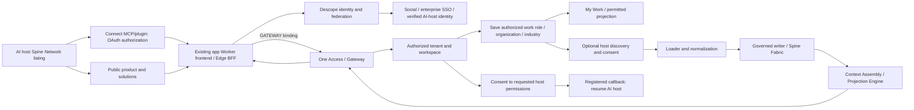

# SpineWorkspace entry, role profiles, and Workers delivery

Status: entry specification updated for role-first onboarding; runtime changes are under review in spineworkspace-live. Live TEST acceptance remains blocked at authenticated session access.
Date: 2026-10-10. Updated: 2026-10-11.
Historical source baseline for the original inspection table: `SpineInnovTech/spineworkspace-live@f5dffed1bc2607a6b282856cbf59e6f007020af5`. Current runtime work builds on `dev@9c10e703f2ad3c0618320c3b002961afedfdabdb`.
Parent branding in this work: Spine InnovTech / Spine InnovTech Private Limited, as directed by the founder. Existing repository identifiers remain unchanged.

## Intended outcome

A person can enter from a Spine Network MCP/plugin listing in an AI host, or explore the public Product, functional Solution, and industry Solution pages before signing up. Both journeys use SpineWorkspace authentication through Descope and resolve an authorized workspace. Authentication offers configured social login, enterprise SSO, and AI-host identity where a supported, verified federation connection exists. The person saves organization or personal-workspace context, industry, and an authorized work role before opening the Workbench. Host discovery and tool connection remain optional and can happen afterward.

Connected, authorized context flows through the existing loader, normalization, governed writer, Spine Fabric, Context Assembly, and projection services. The frontend renders those projections through the server boundary. The current release instruction uses Cloudflare Workers Builds with the existing OpenNext app Worker; the earlier Pages entry proposal below is deferred.

The first implementation covers entry and one connected-context journey. It does not rewrite every service, create separate apps per industry, or change the fixed workspace navigation grammar. Further providers and domain journeys extend the same contracts after this first journey is demonstrated.

## Evidence and current limits

The following observations distinguish source behavior from verified deployed behavior. Repository-relative references below refer to the pinned `spineworkspace-live` baseline.

| Area | Evidence | Assessment |
| --- | --- | --- |
| Descope sign-in | `apps/web/components/auth/descope-flow.tsx` uses `sign-up-or-in` and exchanges the credential with `/api/auth/session`; the session route validates it through the Descope SDK | Implemented in source; an actual authenticated journey has not been exercised in this session |
| Federated identity | `packages/auth/src/index.ts` states that enterprise SAML/OIDC providers federate behind Descope and that discovery requires separate authorization | Contract exists; enabled social/SSO methods in the deployed Descope project are unknown |
| Return paths | Login preserves `next`; signup reads `next`, but its existing `/login` cross-link omits it (`apps/web/app/signup/page.tsx`) | Partial; context can be lost when switching authentication mode |
| Direct entry | `apps/web/proxy.ts` checks a completed onboarding cookie under production strict mode; `lib/auth/post-auth-destination.ts` directs an identity without a tenant to onboarding | Conflicting with the current immediate-My-Work requirement; membership provisioning must remain an authorization prerequisite |
| Membership | `lib/auth/session-identity.ts`, Gateway One Access, and tenant contracts resolve verified membership without a default tenant | Source contract exists; new-user, returning-user, and multiple-tenant outcomes require actual journey evidence |
| Host discovery | `/api/onboarding/host-discovery` reads Gateway `/api/v1/integrations/host-estate`; hosts without a verified report remain declared, and `externalAccounts` is currently empty | Partial; this is not complete discovery of a person's connected external accounts |
| Workspace discovery | `services/gateway/src/platform-discovery.ts` discloses unresolved capabilities and unavailable connection/catalog summaries | Implemented in source; absence must remain distinct from denial and temporary unavailability |
| Projection loading | `lib/projection-route-loader.ts` validates projection/tenant/workspace/principal consistency and source-tenant provenance; `lib/server/gateway-transport.ts` prefers `GATEWAY` | Implemented in source; preserve this path |
| Live Worker | Cloudflare settings API confirmed `spineworkspace-web` has assets, public Descope configuration names, and `GATEWAY → spineworkspace-gateway` | Deployment binding observed; a binding alone does not prove downstream business behavior |
| Pages | Cloudflare projects can be listed with the injected token; Pages Functions support Worker service bindings | Account read access observed; a new Pages deployment has not been created |
| Ingestion | `services/loader/src/index.ts`, `services/pipeline/src/normalizer/normalize.ts`, and the canonical writer contain the ingestion/normalization paths | Source exists; this session has not submitted a real authorized source record or verified its readback |

The public app login/signup endpoints returned HTTP 200, while `auth.spineworkspace.com/login` returned 404. Marketing therefore uses the existing app origin. HTTP 200 does not prove authentication succeeded.

## Two user journey entries

### 1. Connect from an AI host

The person finds Spine Network in a supported AI host's MCP/plugin listing and chooses Connect. Candidate hosts include ChatGPT, Claude, Perplexity, Cursor, Devin, and Hermes; listing, installation, OAuth, and identity capabilities must be verified independently for each host. This list does not claim that every host has a directory or a supported integration today.

The host starts the supported OAuth authorization flow with SpineWorkspace. SpineWorkspace presents its configured authentication choices through Descope: social login, enterprise SSO, or verified AI-host identity. A plugin click or an existing AI-host session is not itself proof of a SpineWorkspace identity. AI-host login is offered only when a supported identity exchange/federation connection can be validated; otherwise the user chooses an available social or SSO method.

After authentication, SpineWorkspace resolves membership and the intended workspace. The person reviews the requesting host/client, workspace, and requested permissions before granting the connection. The authorization server then returns the authorization result to the registered host callback. Where the host supports the flow, use authorization code with PKCE, exact registered redirect URI validation, state validation, and appropriately scoped tokens. User authentication and the host's authorization grant are distinct steps; an app session cookie is not issued to the host as an MCP credential.

The person returns to the AI host with its permitted Spine Network connection ready, and can also open the authorized workspace. Cancelling login or consent leaves the connection ungranted. Revocation and expired grants prevent subsequent access. Host-specific OAuth requirements, authorization-server ownership, token audience, and the current MCP implementation are implementation evidence to inspect before choosing or adding endpoints.

### 2. Explore before signing up

The person finds Spine Network in an AI host, follows its website link, and explores the marketing site. Product and domain/industry solution pages explain the relevant features and offer Sign up / Sign in. Those actions enter the same Descope-backed authentication choices and membership resolution as the direct connection journey.

After authentication and verified membership, the person chooses an authorized work role if no durable profile exists, then enters the permitted workspace without mandatory tool setup. If the journey began with a valid pending host connection, offer to resume its authorization and return to that host after consent. A normal website visitor enters the workspace without a fabricated host grant. Preserve a pending connection using server-validated state or a supported authorization transaction; marketing query parameters must not carry credentials, grant permissions, or supply arbitrary OAuth callback URLs.

### Shared continuation

Both entries converge on verified identity, authorized tenant/workspace membership, and separately consented host/tool connections. Social login does not automatically expose the AI host's tools or accounts. Host discovery uses verified estate reports and eligible provider connections; authorized source data then follows Loader → Normalization → governed Spine Fabric → Context Assembly/projection → the application server boundary. The host receives only the capabilities and data its grant permits, while the workspace renders only the user's permitted projections.

## Shared tenant context and host-owned execution

Spine OAuth authorizes a host to call Spine Network; it does not transfer that host's app credentials or discover its private tools automatically. A host reports only apps it can actually probe, with host attribution, read scopes and `credential_plane: host`. Inventory, authorization bindings, connection ownership and capability routes are distinct from ingested business records. A binding with no executable route must be shown honestly.

The requested ChatGPT custom-connector entry is `https://gateway.spineworkspace.com/mcp`, using the Spine auth authority. Switch that same connector to a direct marketplace MCP URL only after its installation is active; do not create a second connection or claim installation from a URL alone. Runtime availability and a real OAuth handshake remain verification gates.

Within an authorized tenant, people can inspect each reporting host's connected environment. The owning host can execute its permitted local capability and report its result; another host sees the binding but receives `not_executable` when no authorized delegation route exists. Shared context consists of governed Spine records. Workbench reads their server projection rather than invoking host apps directly. Provider credentials remain on the owning host.

A desired Grok/ChatGPT presentation must be backed by real per-host reports, bindings and projection readback. Current source audit found `get_available_actions` reads D1 `tenant_integrations` and top-level host metadata, rather than the owner-described Neon host inventory; complete combined-host visibility is still Partial. Do not publish a fictitious ChatGPT app list or label connection registration as ingestion. Original Gmail/Calendar recovery remains separate from the repaired outbox schema and requires the owning host's original envelopes.

## Delivery options and selected proposal

| Option | Benefit | Cost / limitation |
| --- | --- | --- |
| Pages frontend entry through a Function service binding to the existing OpenNext app Worker | Meets the requested Pages delivery entry while preserving Next server components, session routes, and private Worker bindings | Adds one thin delivery hop; requires origin, cookie, streaming, and cache validation |
| Keep the complete frontend on Workers Static Assets | Matches the current Workers Builds release instruction, accepted hosting ADR, and deployed architecture | Exact-commit TEST deployment and authenticated acceptance still need verification |
| Convert apps/web into a static client app on Pages | Pages directly hosts the client application | Replaces load-bearing server behavior and requires a substantially larger migration; excluded from this first slice |

Current delivery decision (2026-10-11): preserve the existing OpenNext app Worker and use native Cloudflare Workers Builds for TEST from `dev` and production from `main`. The earlier Pages delivery entry is deferred; it must not be deployed as part of this role/profile change. Historical proposal: the Pages delivery entry with the existing Worker as the sole application server. Cloudflare's Next.js Pages guide directs full-stack applications to Workers; a static export cannot preserve this app's server session and projection loaders. Pages Functions officially support `context.env.SERVICE.fetch(context.request)`.

`ADR-2026-10-03-01` currently specifies Workers hosting. Any future Pages entry requires a separately reviewed delivery ADR in `spineworkspace-live`. It preserves Worker-owned application/BFF behavior and the existing single Workbench runtime. It does not silently edit the constitutional canon.

## Authentication and entry behavior

1. Public feature pages retain their content. Sign up and Sign in are prominent actions. Product navigation remains a public product-details link unless the founder explicitly chooses an authentication-only navigation door.
2. Both authentication URLs carry a fixed app-local `next` path. Functional solutions request their registered projection; industry pages without a registered projection request My Work. No industry hostname or entitlement is invented.
3. Sign-up/sign-in cross-links, the Descope flow, callback, and server session exchange preserve the sanitized return path. External and protocol-relative return URLs are rejected by the shared contracts.
4. The three authentication categories are configured social login, enterprise SSO, and verified AI-host identity. A permitted federated host/enterprise method uses the configured Descope connection. A hostname, email suffix, plugin click, or claimed host identity alone never authorizes it. Unconfigured methods are not offered as working methods.
5. When that federation method is unavailable, configured social Descope methods are offered. An explicit identity/authorization denial must be shown; the application must not silently substitute another identity to bypass it.
6. The server validates the Descope credential and resolves tenant/workspace membership. Returning users with a valid saved work profile enter their authorized workspace directly; users without one first choose a work role within their verified membership permissions. Multiple memberships require explicit selection of an authorized tenant. A new user receives an authorized provision/create/join outcome through One Access; failure does not create a default or Customer Zero membership.
7. Verified identity, active membership, and a saved authorized work role are required before Workbench entry. Connection discovery, hydration, plugin selection, and completion of a setup checklist do not block My Work. Removing the onboarding-cookie gate must not remove server membership or projection authorization checks.
8. An unauthorized requested projection displays the access outcome and an available authorized workspace entry. It never renders another tenant's data. Server resolution remains authoritative over the marketing hint.
9. Logout clears the current-host app and identity cookies, awaits Descope SDK logout, clears client identity/projection caches, and navigates fully to sign-in. A failure is shown for retry. Returning sign-in re-resolves membership and current permissions rather than restoring cached authority; logout does not revoke separately granted MCP connections or promise cross-domain cookie deletion.
10. A pending MCP/plugin authorization survives a sign-up/sign-in switch through a validated authorization transaction. Completing authentication does not silently approve the host's permissions. Consent, cancellation, callback validation, expiration, and revocation have explicit outcomes. App logout and host-grant revocation are separate operations with clearly stated effects.

## First connected-context journey

Use Account Success as the first validation projection, without narrowing the product to renewals. A supported source supplies a customer/account plus a related support or activity record under a real, consenting tenant. The workspace should show source-labeled account context and freshness. Other public solution pages retain their distinct domain features and authenticated entry links.

Discovery consumes verified host-estate reports and separately authorized tool/provider connections. It cannot enumerate a host's private tools merely because the person signed in with Google, Okta, or Auth0. Connection ownership and provider credentials remain with the owning host/managed provider; Spine stores references, grants, health, provenance, and evidence.

Flow D must establish identity, tenant, consent, policy, and eligible binding before data enters Loader. Structured records follow validation, mapping, entity resolution, deduplication, and governed promotion. Unstructured evidence retains source references and joins structured context only through the authorized projection. Discovery never writes canonical truth or grants execution.

The browser requests same-origin application endpoints. Server calls use the existing Worker binding transport. RPC is used only where an existing typed service interface supports it; HTTP `fetch` over a service binding remains valid for current Gateway contracts. The browser receives neither bindings nor raw datastore/provider credentials.

Unavailable sources show a disclosed gap; denied sources show denial; stale context shows freshness. Demonstration fixtures are labeled and cannot satisfy live acceptance. The first read journey does not trigger an external write. A later consequential action remains Capability → Govern → Hermes → independent readback → reconciliation.

## Deferred Pages boundary and rollout

- A dedicated Pages preview entry binds to the TEST app Worker. Production and preview bindings cannot share a production tenant/data shortcut.
- Pages serves eligible public/static frontend assets and forwards dynamic application requests to the app Worker. Login, signup, session, callback, authenticated HTML/RSC, API requests, and logout preserve method, body, cookies, query, response status, streaming, and Set-Cookie behavior.
- Signed identity and tenant decisions remain on the server. Client-supplied tenant, role, projection-authority, or forwarded-host headers cannot become trusted claims. The origin contract must explicitly support the Pages preview hostname without presenting it as an authorized tenant or industry.
- Authenticated responses and session/projection APIs are private and not stored in shared cache. Static assets may retain immutable caching. Do not add a blanket SPA fallback that bypasses protected routes or returns HTML for APIs.
- Callback/SSO allowlists use the exact tested frontend origins. A Pages-host session is not assumed to exist on a different host because `iw_session` is host-only.
- Preview must pass before the `app.spineworkspace.com` custom-domain handover. There remains one frontend runtime for domain aliases; separate Pages apps per department are unnecessary.
- The app domain, existing Work aliases, Pages entry, and Worker asset build are treated as a coordinated release. Preserve the known Worker deployment and domain configuration as rollback targets. Roll back delivery routing if session exchange, projection authorization, or asset loading fails.
- Marketing publication is independent and can use its already-working Cloudflare native deployment. This spec does not authorize an unverified replacement of the live workspace.

## UI requirements

Use the approved white/pale-blue surfaces, navy headings, bright-blue buttons, readable type, and consistent focus states for apps/web entry and the first tested workspace surface. The profile control must show canonical name/email, Dashboard, My Settings, persistent System/Light/Dark appearance, Help, and Log Out. Settings groups Personal and Organization sections with search and only supported controls. Choosing a work role never grants administrator membership. Retain the fixed primary sidebar and domain projection contracts. New visuals must be original and relevant; the supplied screenshots are design references, not assets to embed.

Authentication explains only the choice the person needs to make. Discovery appears in Connected Ecosystem with available, consent-needed, denied, revoked, unavailable, and synchronizing states. Service names, worker topology, configuration hashes, and normalizer/RPC details belong in diagnostics rather than the everyday entry flow.

## Acceptance and evidence

The first slice is accepted when a real user completes the following on the deployed preview and then the production release:

1. Completes both entry journeys: directly connecting Spine Network from one verified supported AI host, and exploring its marketing link before signing up. Also arrives from Product, a functional Solution, and an industry Solution with the intended entry context; switches sign-up/sign-in without losing it.
2. Uses each configured authentication category that is actually supported: social, enterprise SSO, and AI-host identity. Unsupported host identity is disclosed rather than represented as working. The server rejects an invalid/expired credential and an unsafe return URL.
3. Resolves a valid tenant/workspace and opens My Work or the permitted projection without completing tool setup. An independent second tenant cannot retrieve the first tenant's projection or connected records.
4. Discovers only verified/authorized host estate, consents to a supported source, and sees its real record after loader/normalization/governed promotion with provenance and freshness. Missing permission, revoked connection, and source failure are disclosed.
5. Receives the projection through the existing app Worker → Gateway binding path. The deferred Pages proposal is not a requirement for this Workers release. Browser network inspection shows no raw internal datastore calls or provider credentials. Session cookies, CSRF/origin checks, private cache rules, streaming, and asset loading behave correctly.
6. Logs out, signs back in, and resumes the correct workspace with current permissions. Desktop, tablet, mobile, keyboard, loading, empty, denied, and error states pass the repository visual and accessibility checks.
7. Reviews and grants the host's requested workspace permissions, resumes the registered host callback, and demonstrates one permitted MCP operation. Rejected consent, invalid callback/state, expired authorization, and a revoked grant cannot access workspace data. A website-only sign-up creates no host grant.

Record source commit, build/deployment identity, redacted screenshots, route outcomes, trace/correlation references, data provenance, and isolation results. Build success and HTTP 200 are separately recorded and cannot substitute for this journey.

## Requirements for execution

The Cloudflare token is present and verified active via the supported proxy. Account listing and Worker binding reads work; Pages write capability will be checked when the reviewed implementation needs it. No duplicate token request is needed.

Deployed Descope provider availability, a real authorized test user/tenant, and a supported consenting source connection remain unverified. Inspect existing secure configuration metadata first. Any missing identity/provider configuration should be supplied through the existing Descope/vault/environment administration path, never as credentials pasted in chat.

Follow spineworkspace-live's feature → dev → staging → main promotion discipline, affected contract tests, changelog/evidence obligations, and live-journey release gate. The initial inspection did not validate app dependencies or startup. The current source checks and built-app local UI checks are recorded below; new-task restoration and live acceptance remain unverified. The marketing environment is separately build-tested.

## Current implementation and live acceptance boundary — 2026-10-11

The app change resolves identity and active tenant membership through Gateway, saves the work profile to that membership, derives projection scope from the selected role intersected with verified permissions, and gates workspace launch before discovery. A shared Settings/My Work return path is retained; a different role's marketing hint cannot override the chosen role. Host reports may be pending or unavailable without preventing entry once the profile is saved. No report means tools are unknown, rather than a claim that no tools exist on the person's machine.

The user confirmed that neither a Descope-authenticated TEST browser session nor the original Grok October 11 Gmail/Calendar session is available in this Codex environment. `https://app.spineworkspace.com/login` is the configured One Auth entry, but a Cloudflare binding is not an authenticated session. Original source envelopes must be recovered by the owning Grok host. Local fixtures, queued receipts, or stored credentials cannot replace that access or prove Fabric ingestion, projections, governed execution, readback, or returning-user continuity.

PR #19 remains a documentation change. The existing marketing pages and their public feature content remain intact; this update does not claim a production app deployment. The broad host-federation gap remains tracked by spineworkspace-live issue #440.

Runtime implementation: draft [spineworkspace-live #444](https://github.com/SpineInnovTech/spineworkspace-live/pull/444) targets `dev`. Full web tests (1,679 passing), Gateway tests (664 passing, five existing pending), whole-web/Gateway/shared configuration typechecks, the TEST OpenNext build, and five built-app local fixture UI checks pass. The fixture used no provider records and cannot satisfy live acceptance.

The newly supplied Descope management network binding is present. Read-only management and public signing-key API requests both returned a Cloudflare HTML 403, preventing management-key/project/test-user/provider verification. This is an API access blocker, not proof that the key is invalid. No management impersonation or replacement authenticated user session was created.
